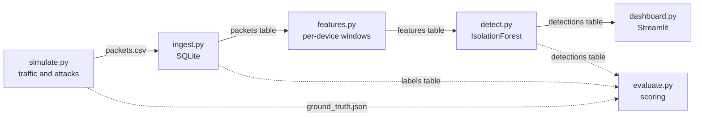

# Bluetooth Security Attack Pipeline

This project simulates Bluetooth Low Energy (BLE) traffic and attacks, turns raw packets into per-device security metrics, and flags unusual behavior with an unsupervised IsolationForest. Every flag comes with a one-sentence explanation in plain English, and a dashboard shows the results and lets you inject a new attack live.

## Why it exists

BLE devices announce themselves in the open, which makes the advertising channel easy to abuse. The hard part of detecting that abuse is not the attacks themselves. It is that normal BLE traffic is already irregular, so a naive detector raises many false alarms.

The pipeline simulates three attacks:

| Attack | What the attacker does | What gives it away |
| --- | --- | --- |
| Flood | A new address sends a packet every 5 to 10 ms | Packet rate far above any normal device |
| Spoof | A second transmitter reuses a real device's address from somewhere else | Signal strength jumps between two levels, 20 to 30 dB apart |
| Timing | A device's gaps become irregular, from 0.2 to 2 times its normal interval | Most gaps are off the device's usual rhythm |

It also simulates four normal behaviors that look suspicious but are not:

| Normal behavior | Why it causes false alarms | How the pipeline tolerates it |
| --- | --- | --- |
| Advertising jitter | BLE adds a random 0 to 10 ms delay to every advertisement, so gaps are never equal | A gap only counts as off rhythm when it is more than 10 ms from the device's usual interval |
| Missed packets on channel hops | A sniffer hears one advertising channel at a time and misses packets (15% in the simulation), which doubles a gap | The usual interval is the median gap, which a few long gaps do not move, and the model learns how many off-rhythm gaps are typical |
| Multipath RSSI swings | Reflections briefly drop the signal by 10 to 20 dB (5% of packets in the simulation), which looks like a second transmitter | Signal strength is smoothed with a 3-packet rolling median, and its variation is measured from the 10th to the 90th percentile |
| Address rotation | Privacy addresses change every few minutes (40% of simulated devices, every 2 to 4 minutes), so devices appear and vanish | Each address gets its own usual interval, windows with fewer than 3 packets are skipped, and windows with fewer than 4 are never flagged |

## How it works



| Stage | What it does |
| --- | --- |
| `simulate` | Generates advertising packets for each device, injects the attacks, and writes `data/packets.csv` and the answer key `data/ground_truth.json` |
| `ingest` | Loads the CSV into SQLite as a `packets` table and a separate `labels` table |
| `features` | Summarizes each device address in 5-second windows: packet rate, gap regularity and signal steadiness |
| `detect` | Scores every window with an IsolationForest, flags the unusual ones and writes a one-sentence reason for each |
| `dashboard` | Shows the summary numbers, a chart over time, the flagged windows with reasons, sensitivity sliders, and buttons to inject an attack or reset to the demo data |
| `evaluate` | Compares the flags with the answer key and writes `docs/results.md` |

The detector never sees the labels. `detect.py` reads only the `features` table, and a test confirms it gives the same result on a database that contains nothing else. The answer key is read only by `evaluate.py` and by the dashboard's optional "Show answer key" toggle, which is off by default.

## Detection

The model is an IsolationForest with 200 trees and a fixed random seed. It needs no labels: it scores each window by how easy it is to separate from the rest.

It is given three features, one per question:

| Feature | Question it answers | Attack it exposes |
| --- | --- | --- |
| `packets_per_sec` | How often does the device send? | Flood |
| `iat_deviation` | What share of its gaps are off its usual rhythm? | Timing |
| `rssi_spread` | How much does its signal strength vary? | Spoof |

Three more features are computed and stored but left out of the model:

| Feature left out | Why |
| --- | --- |
| `iat_median`, `iat_std` | Their size depends on how fast the device advertises, not on whether it is misbehaving |
| `rssi_median` | It reflects how far away the device is, not how it behaves |

**Flagging.** A window is flagged when its anomaly score is at least 0.63 and it contains at least 4 packets.

The first version flagged the top 3% most unusual windows of every run. That quota was replaced because it flags the same number of windows whether a run contains three attacks or one, so with a single attack most of the flags were false alarms (see Results).

**Explanations.** For each window the detector finds the feature furthest above what is typical (a robust z-score using the median and the median absolute deviation) and fills in a sentence, for example:

- "Sent 113.4 packets/s vs. a typical 2.4/s"
- "Signal strength varied by 21 dB within 5 s vs. a typical 4 dB, possibly a second transmitter"
- "100% of gaps were off the device's usual rhythm vs. a typical 15%"

## Results

Measured on 30 simulated runs per scenario (seeds 100 to 129), each 10 minutes long with 8 devices. A window is one device address during one 5-second slice. Recall is the share of attack windows that were flagged; precision is the share of flagged windows that really were attacks.

**All three attacks in every run (90 attacks)**

| Method | Whole attacks caught | Recall | Precision | False alarms per run |
| --- | --- | --- | --- | --- |
| Before: top 3% of each run | 90/90 | 90% | 64% | 10.6 |
| After: score of 0.63+ and 4+ packets | 89/90 | 84% | 84% | 3.5 |
| Rules baseline | 90/90 | 93% | 51% | 19.2 |

**One attack per run (30 attacks)**

| Method | Whole attacks caught | Recall | Precision | False alarms per run |
| --- | --- | --- | --- | --- |
| Before: top 3% of each run | 30/30 | 91% | 22% | 23.0 |
| After: score of 0.63+ and 4+ packets | 30/30 | 86% | 42% | 8.6 |
| Rules baseline | 30/30 | 92% | 24% | 21.2 |

What the numbers say:

- **Before and after.** Replacing the quota cut false alarms by about two thirds in both scenarios, from 10.6 to 3.5 and from 23.0 to 8.6 per run.
- **The cost.** Recall fell by 5 to 6 points, and one of the 120 attacks (a timing attack) was missed entirely. Timing attacks are the weak spot.
- **Against the rules baseline.** The detector raises far fewer false alarms than three fixed rules (more than 20 packets per second, signal variation above 15 dB, or more than half the gaps off rhythm), at lower recall.
- **Still unsolved.** With a single attack per run, precision is 42%, so more than half of the flags are still false alarms.

The score threshold and minimum packet count were chosen on one set of runs (seeds 200 to 229) and reported on a different set (seeds 100 to 129), so nothing was tuned on the data it is scored on. The full tables, including results by attack type, are in [docs/results.md](docs/results.md).

## Quick start

### Option A: Docker

```bash
docker compose up --build
```

Then open http://localhost:8501. The container builds the demo data on start.

### Option B: Local (Python 3.12)

```bash
python -m venv .venv
```

Activate the environment with `.venv\Scripts\Activate.ps1` on Windows PowerShell, or `source .venv/bin/activate` on macOS and Linux. Then:

```bash
pip install -r requirements.txt
python -m src.demo_data
streamlit run src/dashboard.py
```

`python -m src.demo_data` builds the demo dataset (8 devices, 10 minutes, one of each attack, seed 42) if `data/ble.db` does not exist yet.

### Run the pipeline stage by stage

```bash
python -m src.simulate --devices 8 --minutes 10 --attacks flood,spoof,timing --seed 42
python -m src.ingest --csv data/packets.csv --db data/ble.db
python -m src.features --db data/ble.db --window 5
python -m src.detect --db data/ble.db
```

### Evaluate

```bash
python -m src.evaluate --db data/ble.db     # score the current dataset
python -m src.evaluate --seeds 100-129      # score fresh runs and write docs/results.md
python -m src.evaluate --tune 200-229       # show how the two detector settings were chosen
```

### Tests

```bash
pip install -r requirements-dev.txt
python -m pytest
```

Seven tests cover reproducibility, well-formed data, labels matching the answer key, the detector not being able to see the answers, the demo attacks being flagged, and an end-to-end run.

## Repository layout

```
.
├── src/
│   ├── simulate.py          # generates BLE traffic, injects attacks, writes the CSV and the answer key
│   ├── ingest.py            # loads the CSV into SQLite, with labels in a separate table
│   ├── features.py          # builds per-address, per-window features
│   ├── detect.py            # scores windows with an IsolationForest and explains the flagged ones
│   ├── evaluate.py          # scores the detector against the answer key and a rules baseline
│   ├── demo_data.py         # builds the seed-42 demo dataset by running the whole pipeline
│   └── dashboard.py         # the Streamlit dashboard
├── tests/
│   └── test_pipeline.py     # seven checks that the pipeline keeps its promises
├── docs/
│   ├── results.md           # the full evaluation tables
│   ├── dashboard.png        # screenshot of the dashboard
│   └── dashboard.pdf        # the dashboard page saved as a PDF
├── .streamlit/
│   └── config.toml          # light theme, no usage statistics
├── Dockerfile               # image that builds the demo data and runs the dashboard
├── docker-compose.yml       # one service, port 8501
├── .dockerignore            # keeps local files out of the image build
├── requirements.txt         # libraries needed to run the project
├── requirements-dev.txt     # the same, plus pytest
└── README.md
```

The `data/` folder is created when you run the pipeline and is not part of the repository.

## Tech stack

| Area | Tools |
| --- | --- |
| Language | Python 3.12 |
| Data | NumPy, pandas, SQLite |
| Model | scikit-learn (IsolationForest) |
| Dashboard | Streamlit |
| Tests | pytest |
| Packaging | Docker, Docker Compose |

## Data

Everything is synthetic. No real devices, captures or people are involved, and every address is random. The same seed always produces the same data.

## Limitations

- **Synthetic data only.** The detector has not been run on real captures, so the results describe the simulator, not the field.
- **One global baseline.** "Typical" is measured across all devices together, not per device, so a device is judged against the crowd and not against its own history.